# Ecological Species Distribution Modeling | R, XGBoost & Spatial Analytics

**Environmental data science portfolio project** · Predicting native tree species presence across forest plots in New South Wales, Australia.

[**Results & technical interpretation**](results/RESULTS_AND_INTERPRETATION.md) · [**Portfolio**](https://ys30.github.io/)

## At a glance

| Dataset | Modeling | Best reported validation result |
|---|---|---|
| 9,336 labeled species–plot records; 8 tree species | Logistic regression → Random forest → XGBoost | **ROC AUC 0.9396 · Log loss 0.1693** |

> **Evidence note:** These are historical **validation** scores documented in the research report, not independently reproduced benchmark results or scores on the unlabeled test set. The dataset has **8.0% positive observations**, making minority-class recall and probabilistic evaluation particularly important.

## Problem & approach

Species occurrence depends on environmental gradients, spatial context, and taxon-specific differences. I built an R-based binary classification workflow to assess whether combining these inputs improves predictions compared with simpler baselines.

- **Data engineering & EDA:** Examine class imbalance, climate and soil distributions, spatial coordinates, categorical features, and data quality.
- **Feature design:** Compare environmental-only, coordinate-only, and combined environmental–geographic–species predictors; encode species and other categorical attributes.
- **Model benchmarking:** Evaluate logistic regression, random forest, and regularized gradient-boosted trees using log loss and ROC AUC.
- **Optimization:** Tune XGBoost with cross-validation, learning rate, tree depth, boosting rounds, and row/column subsampling.
- **Interpretation:** Review feature importance and the limits of spatial inference, then export species-presence probabilities for unlabeled records.

**Stack:** R · tidyverse · caret · randomForest · xgboost · pROC · ggplot2 · ecological & spatial data

## Selected results

### Model comparison — historical validation

| Model | Log loss ↓ | ROC AUC ↑ |
|---|---:|---:|
| Logistic regression | 0.2569 | 0.7882 |
| Random forest | 0.2271 | 0.9343 |
| **XGBoost** | **0.1891** | **0.9369** |

### Feature-set experiments — XGBoost

| Predictors | Log loss ↓ | ROC AUC ↑ |
|---|---:|---:|
| Environmental + species + easting/northing | 0.1737 | 0.9351 |
| **Environmental + species + latitude/longitude** | **0.1693** | **0.9396** |
| Environmental only (no species identity) | 0.3119 | 0.5239 |
| Easting/northing only | 0.3066 | 0.5253 |
| Latitude/longitude only | 0.3053 | 0.5394 |

The combined-feature configuration performed best in the **reported random-split validation**. This comparison does **not** isolate the effect of spatial coordinates, because the environmental-only configuration also omits species identity.

### Classification trade-off

A separate reported tuned-XGBoost classification evaluation found **93.25% accuracy**, **70.65% balanced accuracy**, **43.11% presence recall**, and **98.17% absence specificity**. These numbers highlight why accuracy alone is inadequate with an 8% positive class. The precise configuration linking this confusion matrix to the feature-set results still requires verification.

### What the model learned

The historical gain-based feature-importance plot ranked **annual temperature, latitude, longitude, and annual rainfall** among the leading predictors. Species identity indicators also contributed. These are **predictive associations**, not causal effects or proof of interspecies interactions.

For tables, methodology notes, figure inventory, and limitations, see [Results and interpretation](results/RESULTS_AND_INTERPRETATION.md).

## Exploratory analysis — generated from training data

The following figures are generated from the repository's labeled training CSV, rather than illustrative or simulated data.

### Class imbalance and species-specific occurrence

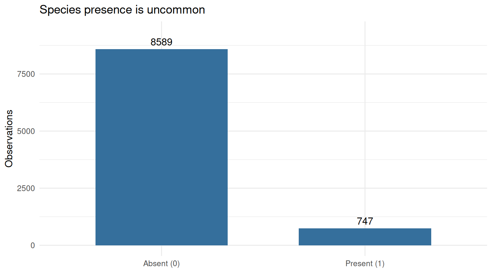

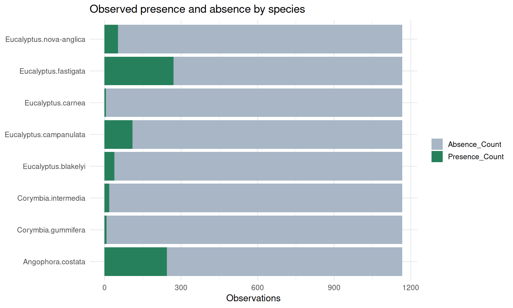

Only **8.0%** of labeled observations are presences. Per-species prevalence varies substantially, so the high overall accuracy of a presence classifier must be interpreted alongside minority-class recall. These counts describe **species-specific records**, not verified pairwise co-occurrence.

### Environmental and geographic feature distributions

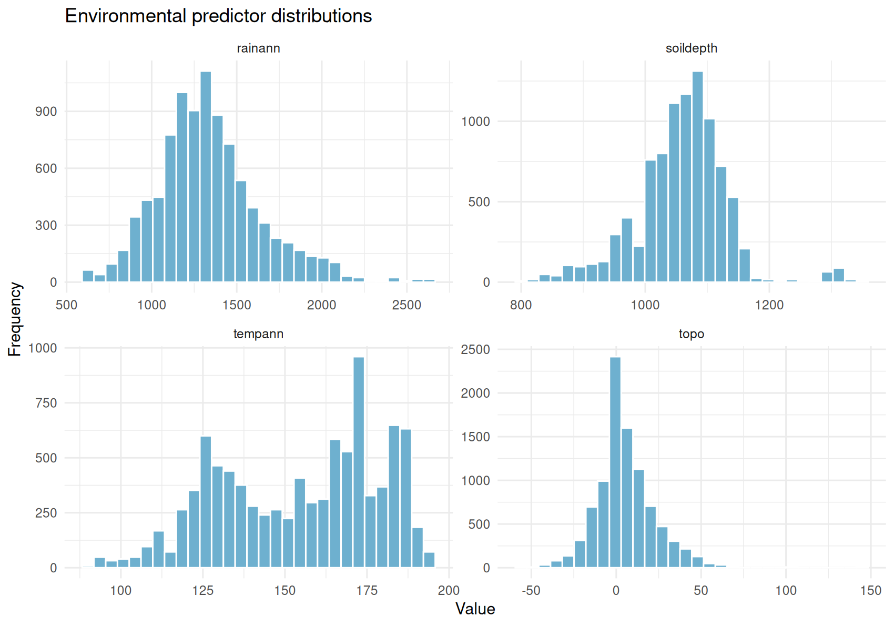

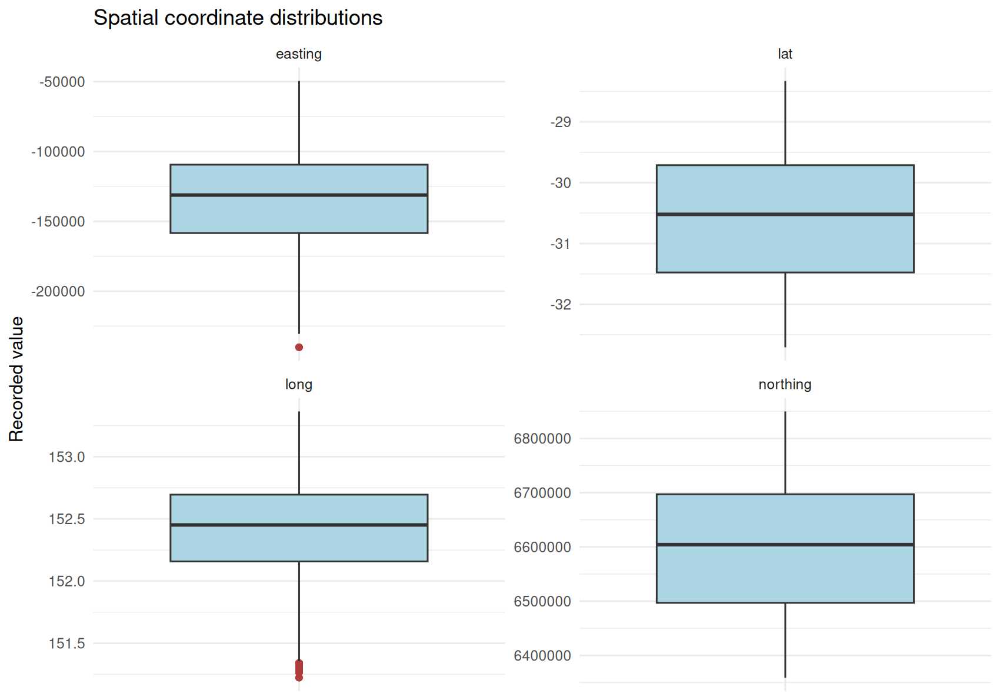

The faceted plots use separate axes for predictors measured on different scales. Temperature scaling and projected coordinate reference system remain to be confirmed before assigning physical units.

### Predictor correlations

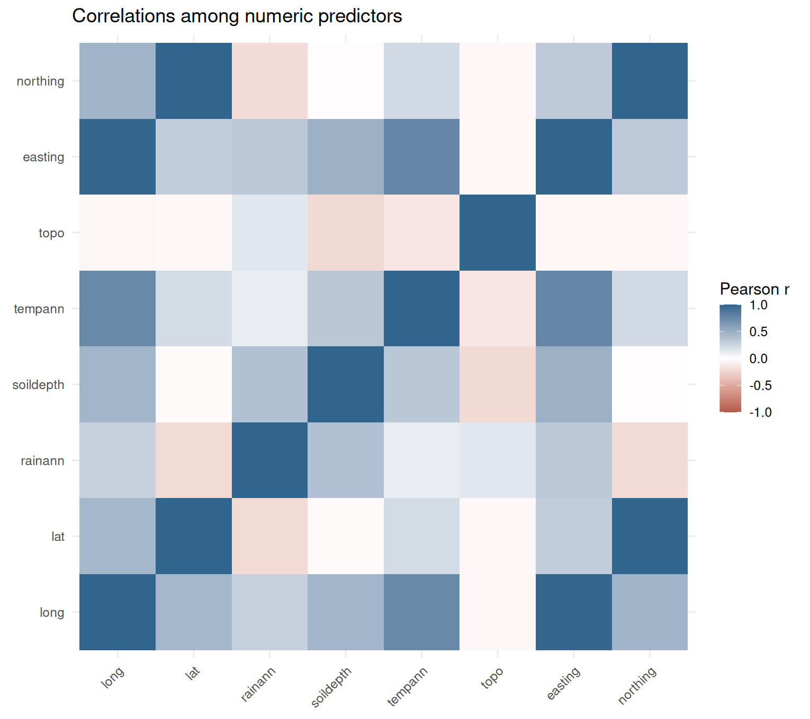

The matrix includes continuous environmental and coordinate variables, excluding numeric codes for categorical attributes. High correlations between geographic coordinate representations should be considered when interpreting feature importance.

**Reproducibility:** [R figure script](scripts/05_export_portfolio_figures.R) · [Automated GitHub workflow](.github/workflows/build-sdm-figures.yml) · [Species summary CSV](results/species_summary_recomputed.csv) · [Correlation CSV](results/numeric_correlations.csv).

Run locally from the repository root:

```bash
Rscript scripts/05_export_portfolio_figures.R
```

## Reproducible workflow

```text
data/
  train.csv
  test.csv
scripts/
  00_EDA.R
  00_baselines_logit_rf.R
  01_feature_sets_and_spatial_cv.R
  02_tune_xgboost_caret.R
  03_evaluate_tuned_xgboost.R
  04_train_full_cv_nrounds_predict.R
  05_export_portfolio_figures.R
  06_evaluate_plot_holdout.R
results/
  RESULTS_AND_INTERPRETATION.md
  submission_xgb_tuned.csv
```

Run the numbered scripts from the repository root with the packages used in each script installed. The code covers exploratory analysis, baseline fitting, feature-set comparisons, tuning, validation, and probability export. **Historical results are not yet accompanied by a complete saved, machine-readable validation benchmark**, so exact numerical reproduction remains a work item.

## Plot-grouped holdout evaluation — verified results

[](https://github.com/ys30/Ecological-SDM-XGBoost/actions/workflows/evaluate-sdm-xgboost.yml)

The [standalone evaluation script](scripts/06_evaluate_plot_holdout.R) holds out entire plot IDs (234 plots; 1,872 observations), while fitting on 933 distinct plots (7,464 observations). Internal five-fold CV also groups by plot, selecting 500 boosting rounds. **This evaluates unseen plots, not geographic-block extrapolation**, and is a separate experiment from historical random-split results.

| Metric | Plot-held-out XGBoost |
|---|---:|
| ROC AUC | **0.9377** |
| Average precision (PR-AUC, stepwise) | **0.6276** |
| Log loss | **0.1653** |
| Precision at threshold 0.5 | 0.7209 |
| Recall at threshold 0.5 | 0.3690 |
| F1 at threshold 0.5 | 0.4882 |
| Specificity at threshold 0.5 | 0.9859 |
| True positives / false positives | 62 / 24 |
| True negatives / false negatives | 1,680 / 106 |

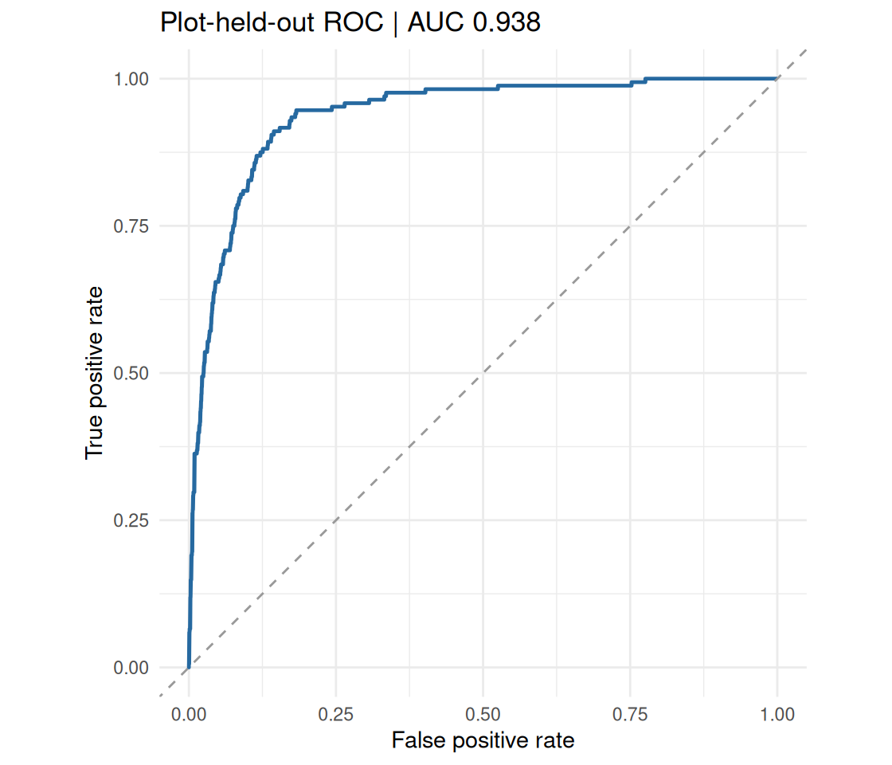

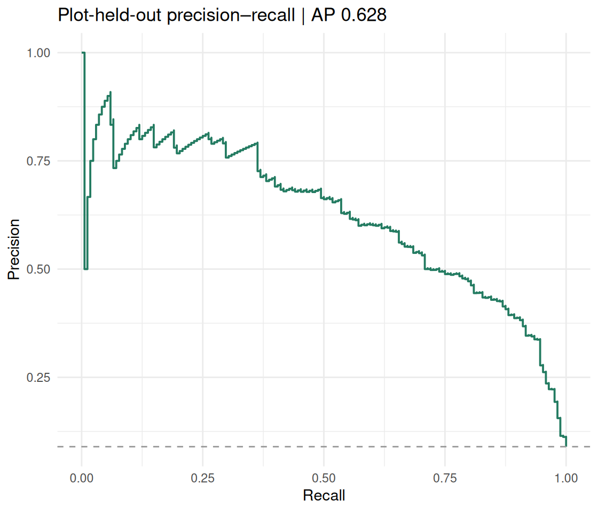

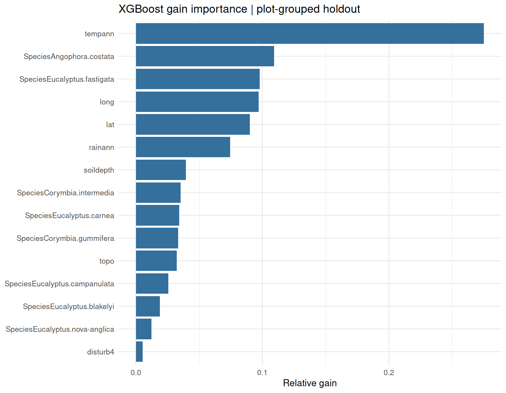

**Interpretation.** Despite strong ranking performance, the default 0.5 threshold misses 106 of 168 held-out presences (recall 36.9%). Threshold selection should therefore reflect ecological costs of missed presences versus false positives, using separate calibration or validation data. The top gain-ranked predictors are annual temperature (27.5%), *Angophora costata* identity (10.9%), *Eucalyptus fastigata* identity (9.8%), longitude (9.7%), and latitude (9.0%). Gain indicates contribution to model splits, **not causal ecological effects**.

**Reproducible outputs:** [Metrics](results/plot_holdout_metrics.csv) · [Per-record predictions](results/plot_holdout_predictions.csv) · [Full feature importance](results/plot_holdout_feature_importance.csv) · [Evaluation script](scripts/06_evaluate_plot_holdout.R).


## Geographic transfer stress test — verified longitude-block CV

[](https://github.com/ys30/Ecological-SDM-XGBoost/actions/workflows/evaluate-sdm-longitude-blocks.yml)

The [geographic validation script](scripts/07_longitude_block_cv.R) partitions whole plots into five consecutive, non-overlapping longitude bands and evaluates each held-out band. Geographic coordinates are **excluded from predictors**, leaving environmental and species information. The model uses a fixed 300-round boosting budget for each fold; this is a distinct feature set and tuning protocol from the plot-held-out experiment.

**Five-fold results (unweighted fold averages):** mean ROC AUC **0.8895** (SD 0.0415); mean average precision **0.4474**; mean log loss **0.1895**. The overall observed presence rate is **8.0%**.

| Held-out longitude band | ROC AUC | Average precision | Recall at 0.5 | Presence rate |
|---|---:|---:|---:|---:|
| 1 | 0.8370 | 0.2808 | 0.4021 | 5.20% |
| 2 | 0.9374 | 0.5535 | 0.1304 | 8.64% |
| 3 | 0.9160 | 0.5473 | 0.2252 | 8.07% |
| 4 | 0.8999 | 0.4714 | 0.1325 | 8.91% |
| 5 | 0.8573 | 0.3842 | 0.4709 | 9.19% |

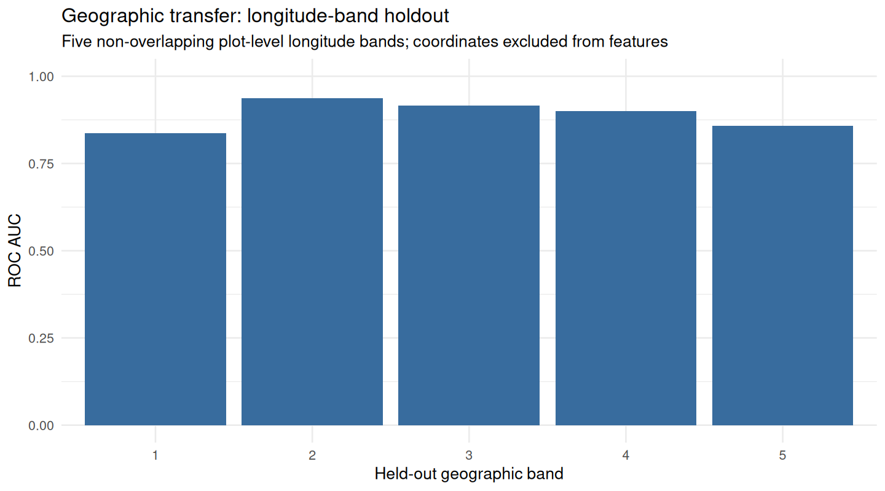

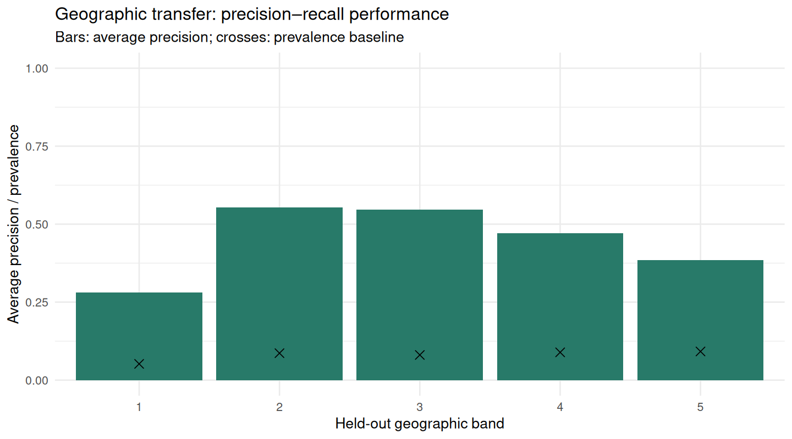

**Interpretation:** Ranking quality remains substantial in each band, but positive-class recall at a 0.5 threshold varies from **13.0% to 47.1%**. This heterogeneity is important for ecological decisions where missed occurrences carry costs. Mean ROC AUC is lower than the separate plot-held-out experiment (0.8895 vs 0.9377), but **the difference cannot be attributed solely to geographic extrapolation** because predictors and training protocols differ. Longitude bands also do not provide full two-dimensional spatial blocking or independent external validation.

**Audit files:** [Per-fold metrics](results/longitude_block_cv_metrics.csv) · [Summary](results/longitude_block_cv_summary.csv) · [Out-of-fold predictions](results/longitude_block_cv_predictions.csv).


## Matched-feature validation comparison — verified

[](https://github.com/ys30/Ecological-SDM-XGBoost/actions/workflows/evaluate-sdm-matched-protocols.yml)

The [matched comparison script](scripts/08_matched_protocol_comparison.R) evaluates **identical environmental/taxon features** (without longitude/latitude), XGBoost parameters, and a fixed 300 boosting rounds using one random plot-level holdout and five longitude-band holdouts.

| Metric | Random plot holdout (one split) | Longitude-band CV (mean of five bands) |
|---|---:|---:|
| ROC AUC | **0.9289** | **0.8895** |
| Average precision | **0.5767** | **0.4474** |
| Log loss | **0.1790** | **0.1895** |
| Recall at threshold 0.5 | **0.3214** | **0.2722** |

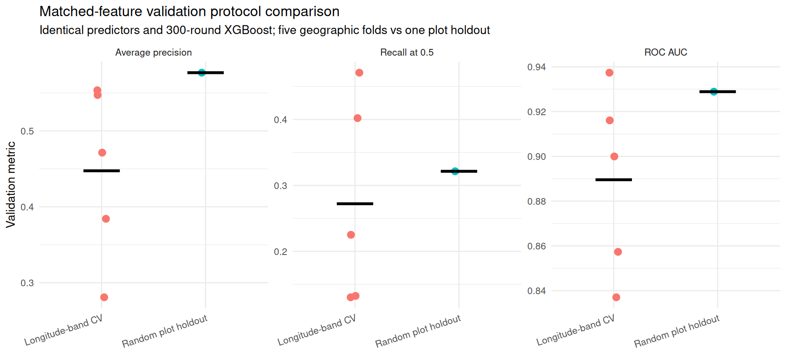

**Interpretation:** The geographic-band mean ROC AUC is 0.0393 lower, and average precision is 0.1292 lower, than the single random plot holdout. This supports geographic transfer as a relevant robustness concern. However, the single random split has unmeasured sampling variability; fold averages are not a paired experiment or a formal significance test, and training sets are not identical. Average precision also depends on positive-class prevalence.

**Audit files:** [Protocol-level results](results/matched_protocol_metrics.csv) · [Summary](results/matched_protocol_summary.csv) · [Reproducible script](scripts/08_matched_protocol_comparison.R).


## Probability calibration and decision-threshold sensitivity

[](https://github.com/ys30/Ecological-SDM-XGBoost/actions/workflows/evaluate-sdm-calibration.yml)

The [calibration script](scripts/09_calibration_thresholds.R) analyzes the **existing plot-held-out predictions** without retraining. It computes the Brier score against a prevalence-only baseline, a 10-bin reliability diagram, and precision/recall/F1 across decision thresholds from 0.05 to 0.95.

**Status:** Workflow configured; calibration numbers and plots are pending verified execution. The threshold sweep is **exploratory**: selecting a threshold on this holdout and reporting its performance on the same holdout would be optimistically biased. Operational thresholds should be selected with separate validation data or nested cross-validation.

## Technical judgment & next steps

- **Spatial leakage:** Records can share plots. Current code shows random/stratified validation; plot-grouped and spatially blocked holdouts are needed before claiming transfer to new geographic locations. A script filename mentioning spatial CV is not evidence that blocking was implemented.
- **Rare-presence detection:** Evaluate precision–recall AUC, sensitivity, F1, and calibration alongside ROC AUC and log loss; choose decision thresholds according to survey or conservation costs.
- **Ablation design:** Separate the incremental contributions of species identity, environmental predictors, and coordinates through controlled feature ablations.
- **Reproducibility:** Save validation predictions, folds, seeds, model parameters, metrics, and generated figures; verify temperature scaling and coordinate reference system.
- **Explainability:** Add species-specific partial dependence/SHAP diagnostics, checking correlated-predictor limitations before ecological interpretation.

## Relevance to environmental & climate data science

This case study demonstrates **tabular environmental data analysis, nonlinear ML, model selection, geographic feature engineering, evaluation under class imbalance, and careful communication of uncertainty**—skills transferable to ecological monitoring, climate-risk analytics, remote sensing, and environmental decision support.

[Explore more projects in my portfolio](https://ys30.github.io/)

## License

MIT License
