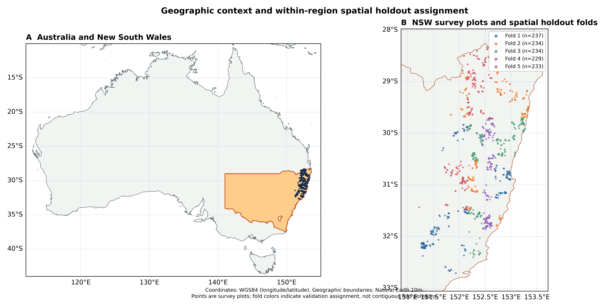
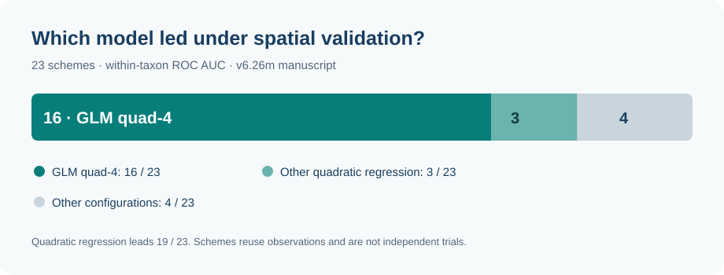
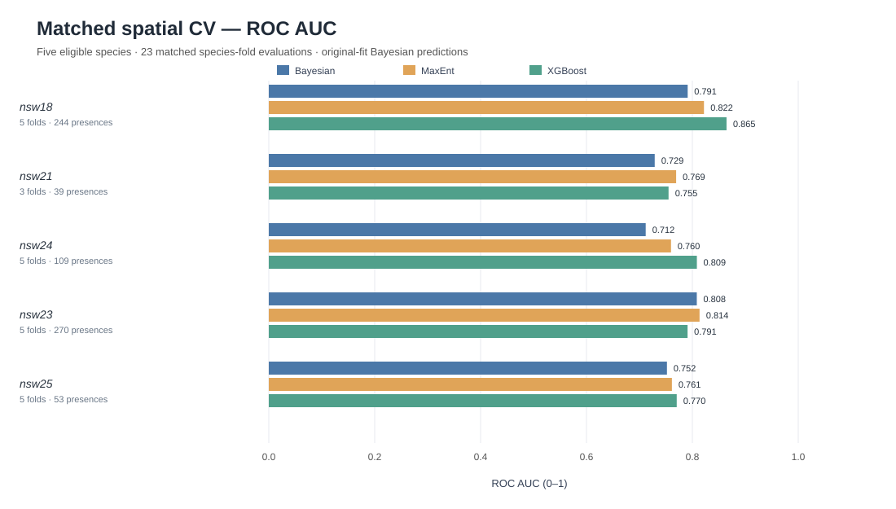
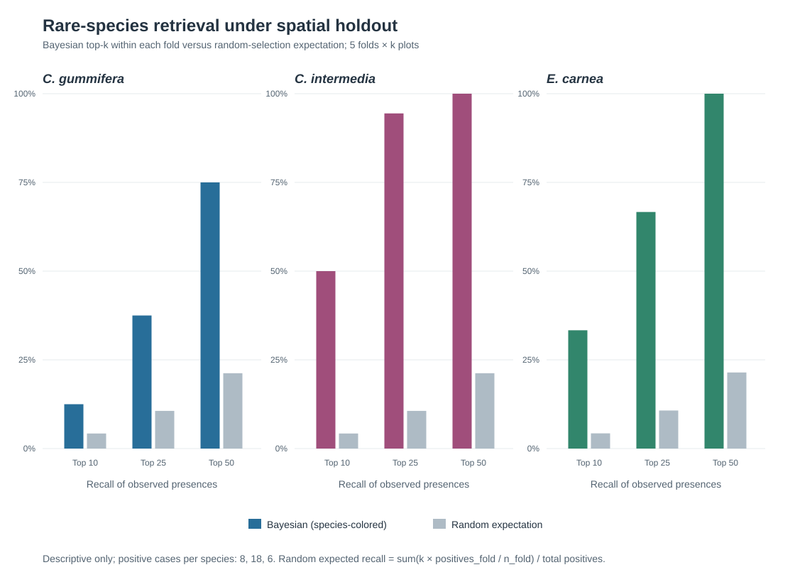
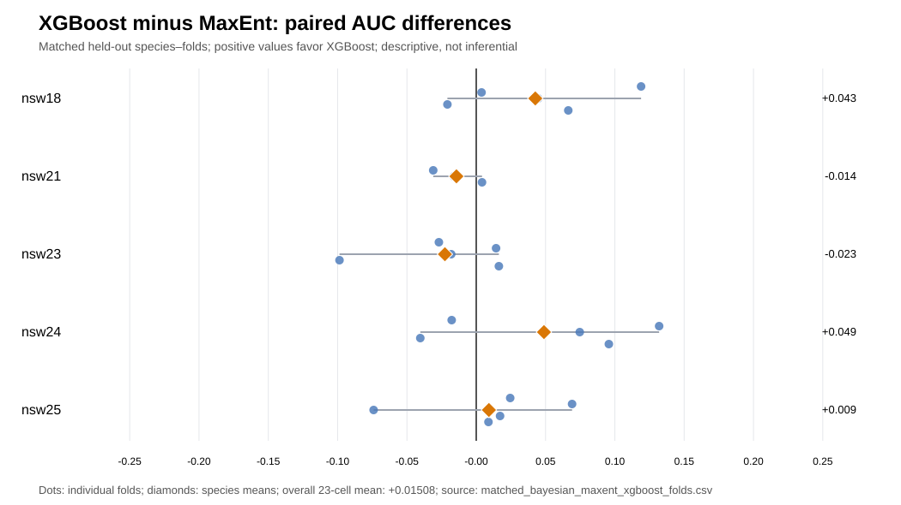
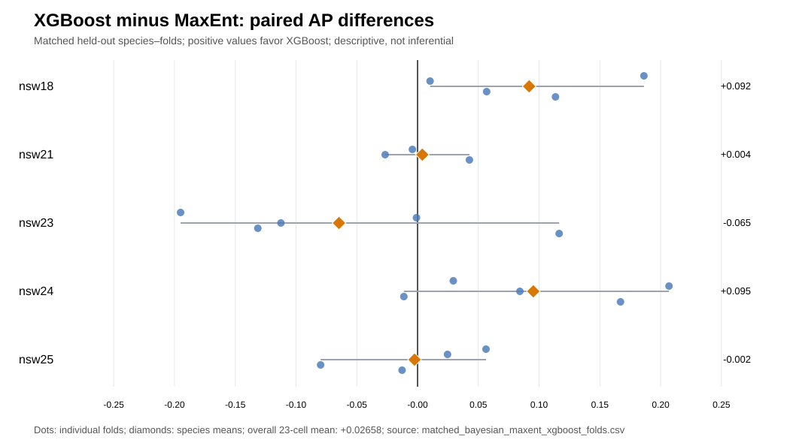
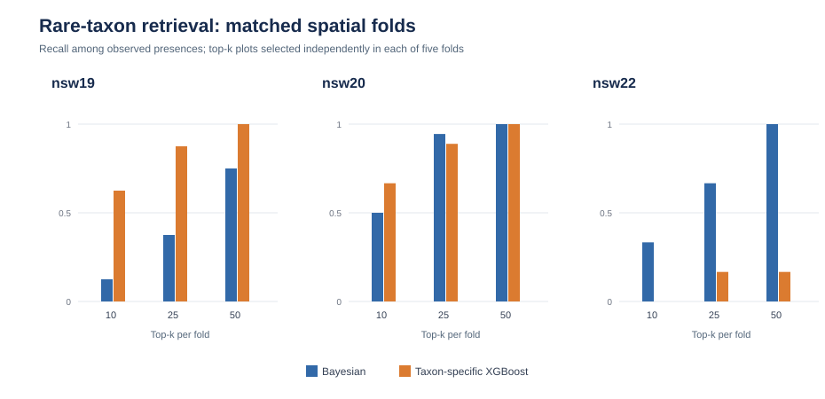

# Spatially Robust Species Distribution Modeling | Research & Decision Analytics

**Python · R · XGBoost · MaxEnt · GLM · GLMM · Bayesian hierarchical models · Geospatial ML · Model evaluation**

> **Industry takeaway:** The best model is not necessarily the most complex. Across **1,167 NSW survey plots, eight anonymized taxa, 12 common model configurations across 23 spatial validation schemes** (14 total including expanded configurations), with GLMM refitted across all 23 schemes. The latest v6.26m benchmark finds **GLM quad-4 leading 16/23** and quadratic regression models leading **19/23** schemes. Model rankings changed with geographic holdouts, target encoding, and whether performance was aggregated across taxa. These are retrospective within-region findings, not deployment guarantees.

[**Visual portfolio case study**](https://ys30.github.io/projects/ecological-sdm-xgboost.html) · [**Study region map**](results/figures/figure1_geographic_nsw_holdouts.png) · [**Rare-taxon prioritization figure**](results/figures/24_rare_species_retrieval_publication.svg)

## What I built — transferable to industry

- **Leakage-aware evaluation:** Two outcome-blind geographic partition strategies (quantile blocks and k-means clusters), five held-out folds, 5–20 km training buffers, and a 23-scheme robustness matrix.
- **Model benchmarking:** Matched holdouts for logistic regression, MaxEnt, pooled/per-taxon XGBoost, and hierarchical Bayesian models; comparison of ranking, probability accuracy, calibration and uncertainty.
- **Hyperparameter sensitivity:** Exploratory nested spatial tuning on three designs. Tuning narrowed the pooled-versus-per-taxon XGBoost gap, but neither tuned variant surpassed the quadratic logistic baseline on the reported within-taxon AUC comparisons. These v6.25 results are from the author-provided manuscript and are **pending a fresh independently verified CI replay**.
- **Decision support:** Retrospective top-k survey prioritization for rare taxa, explicitly comparing detections recovered at fixed inspection budgets and checking whether tuned false-positive thresholds transfer across folds.
- **Reproducibility:** Versioned Python/R workflows, source/provenance checks, GitHub Actions and documented limits of reusing sensitive plot-level records.

## Research findings at a glance

| Question | Evidence from latest v6.26m manuscript | Business / applied-ML relevance |
|---|---|---|
| Does a larger model win? | GLM quad-4 led **16/23** schemes; quadratic regressions collectively led **19/23** | Benchmark against well-specified interpretable baselines |
| Is validation geometry important? | Pooled XGBoost beat MaxEnt under quantile blocks but trailed under k-means | Test model rankings under realistic geographic shift |
| Does tuning settle the ranking? | Tuned per-taxon XGBoost remained **0.021–0.034 AUC below** quadratic GLM across three designs (approximate model-based intervals; exploratory) | Tune models *inside* training folds; distinguish tuning from external validation |
| Can pooled metrics mislead? | Cross-taxon pooled AUC inflated by **0.07–0.11**; prevalence-only score reached **0.77** | Select metrics aligned to the actual prediction task |
| Can scores guide scarce field resources? | Fixed top-25-per-fold screening recovered **17/18** recorded detections for one sparse taxon, but only **3/8** for another | Evaluate ranking at operational budgets, not AUC alone |

### Spatial design

### Model comparison and sensitivity

*This figure visualizes the historical matched three-pipeline comparison, not the expanded v6.25b thirteen-configuration ranking. The new winner-count summary above reflects v6.26m, while the manuscript Figure 4 provides the complete rank/AUC heatmap.*

### Field decision-support example

**Scope:** One NSW survey, eight taxa, retrospective within-region spatial validation. Sparse-taxon rates are unstable; observations are detections, not detection-corrected occupancy. The v6.25b manuscript is pre-submission, its nested tuning exploratory, and its latest code/results release is pending reproducibility and licensing checks. Do not interpret these results as a production field deployment or independent-region transfer.

## Updated manuscript results — v6.26m (23-scheme GLMM-complete benchmark)

The latest manuscript and supplementary information report **14 total configurations**, including **12 common configurations fitted across all 23 spatial validation schemes**. The GLMM expansion is complete (scripts `51_ems_r_models.R` and `51c` for the remaining 21 schemes). The earlier **18/23** headline is superseded by the new full-benchmark ranking:

- **GLM quad-4 leads 16/23 schemes** by within-taxon ROC AUC; a quadratic regression (GLM quad-4, GLM quad-RT, or GLMM quad-RT) leads **19/23**.
- **GLM quad-4 has the best average rank in 10/11 scheme families**; GLMM quad-RT leads under the 6×6-block family.
- **GLMM quad-RT beats MaxEnt N4 in 20/23 schemes** and pooled XGBoost N4 in **21/23**.
- Adding squared predictors raises within-taxon AUC in **all 23 schemes**, by **0.010–0.051** for per-taxon GLM and **0.018–0.046** for GLMM.
- Pooled XGBoost N4 exceeds MaxEnt N4 in **11/23** schemes (or **14/23** with categorical predictors), illustrating sensitivity to predictors and partition geometry.

*Figure derived from the manuscript v6.26m Results §3.3; counts are descriptive because the spatial schemes reuse the same underlying observations. This chart is a summary of reported results, not a newly executed model replay.*

**Reproducibility:** The supplementary information documents scripts 50–63, including `51c` GLMM completion, and points to the [Zenodo research archive](https://doi.org/10.5281/zenodo.24451053) and research commit `6d54748421421048f8d2be13d862861ea6c120ce`. Confirm archive access and licensing before reusing plot-level data.

---

## Historical repository notes and verified experiments

## Buffered spatial validation: GLM-only sensitivity

The [verified alternative-partition buffer refits](results/BUFFERED_GLM_ALTERNATIVE_SPATIAL_VERIFIED.md) excluded training plots within 0, 5, 10, or 20 projected-distance km of any held-out plot and refitted both per-taxon regularized GLMs. Quadratic AUC changed **0.9022 → 0.9027 → 0.8994 → 0.8913**; linear AUC **0.8892 → 0.8894 → 0.8864 → 0.8771**. Quadratic GLM retained higher pooled AUC/AP at every radius, while absolute discrimination fell at 20 km. Training-set shrinkage and unverified source CRS metadata limit causal interpretation; these are **GLM-only within-dataset results**, not a matched buffered Bayesian comparison or external validation.

## Taxon-cluster uncertainty for the four-model comparison

A [verified 20,000-resample eight-taxon bootstrap](results/FOUR_MODEL_TAXON_BOOTSTRAP_VERIFIED.md) found GLM quadratic minus Bayesian quadratic equal-taxon mean ΔAUC **+0.0064** (exploratory 95% interval **−0.0267 to +0.0397**) and ΔAP **+0.0277** (**−0.0418 to +0.1218**). All reported intervals for GLM–Bayesian and quadratic–linear contrasts cross zero. **Pooled model ranking does not establish a stable advantage across taxa**; intervals are exploratory with only eight taxa and are not confirmatory significance tests.

## Verified four-model comparison on identical spatial holdouts

The [matched four-model audit](results/FOUR_MODEL_ALTERNATIVE_SPATIAL_VERIFIED.md) verified identical 9,336 held-out plot–taxon records for per-taxon L2-regularized GLM linear/quadratic and hierarchical Bayesian linear/quadratic on the alternative spatial five-fold partition. **Quadratic GLM** achieved the highest pooled AUC (**0.9022**) and AP (**0.4284**); **quadratic Bayesian** achieved the lowest pooled Brier (**0.05591**) and log loss (**0.18730**). Across 34 eligible taxon–fold cells, GLM quadratic minus Bayesian quadratic mean ΔAUC was **+0.00683** and ΔAP **+0.02460**; across 40 cells ΔBrier was **+0.00031**. These are exploratory within-dataset descriptive differences, not independent external validation or proof of universal superiority. Taxon heterogeneity remains a central limitation.

## Taxon influence: important qualification

A [verified second-partition taxon-exclusion audit](results/SECOND_PARTITION_TAXON_EXCLUSION_VERIFIED.md) shows the pooled quadratic advantage is **not uniform across taxa**. With all eight taxa, pooled quadratic-minus-linear differences were ΔAUC **+0.0143**, ΔAP **+0.0727**, and ΔBrier **−0.00647**. When **both nsw18 and nsw24** are excluded from evaluation, the differences reverse (ΔAUC **−0.0069**, ΔAP **−0.0314**, ΔBrier **+0.00028**). These are evaluation-subset exclusions, **not retraining without the taxa**. The defensible conclusion is taxon-dependent nonlinear benefits, not universal quadratic superiority.

## Alternative-partition diagnostics (verified)

The [second-partition extended audit](results/SECOND_PARTITION_EXTENDED_DIAGNOSTICS_VERIFIED.md) passed all MCMC thresholds across ten fits (max Rhat **1.0082**, min bulk/tail ESS **814/1,412**, min BFMI **0.705**, zero divergences or treedepth hits). Quadratic versus linear improved pooled Brier by **0.00647** and ECE10 by **0.00581**, but Brier improved for only **5/8 anonymous taxa**, with much of the gain from nsw18 and nsw24. Mean held-out residual five-nearest-neighbor Moran's I fell **0.2815 → 0.2471** (24/40 cells improved); residual spatial autocorrelation persists. All are within-dataset sensitivity results, not external validation.

## Alternative spatial partition robustness (November 2026)

A second outcome-blind spatial partition (15 geographic clusters into five folds; adjusted Rand index 0.0955 versus the original partition) was used to **refit both linear and quadratic hierarchical Bayesian models**, 10 successful four-chain jobs in total. The [verified paired audit](results/ALTERNATIVE_SPATIAL_BAYESIAN_VERIFIED.md) found 34 eligible taxon–fold AUC/AP cells: mean paired ΔAUC **+0.01675**, ΔAP **+0.02299**; across all 40 cells, ΔBrier **−0.00648** and ΔLog loss **−0.01741**. Pooled AUC was **0.8856 → 0.8999** and pooled AP **0.3360 → 0.4087**. These are favorable **within-dataset alternative-partition** results, **not external validation**.

## Verified Bayesian specification extension (November 2026)

A five-fold Bayesian sensitivity analysis compared the archived hierarchical baseline with quadratic rainfall/temperature responses and a nonpooled taxon-specific model. This is **within-dataset model-specification validation, not an independent external cohort**. The original three-pipeline comparison uses 23 eligible matched taxon–fold cells; the expanded Bayesian AUC/AP analysis has 30 eligible cells.

On the **original 23 cells**, quadratic Bayesian improved mean paired AUC by **+0.0453**, AP by **+0.0831**, and Brier by **−0.0118** relative to archived Bayesian predictions. In the expanded analysis, mean paired AUC was **+0.0378** and AP **+0.0813**. Across all held-out records, pooled Brier improved **0.06084 → 0.05404**, 10-bin ECE **0.01985 → 0.01255**, and mean residual 5-NN Moran's I **0.341 → 0.291**. Positive residual spatial autocorrelation remains. Excluding nsw18, the quadratic gains retained favorable directions. These results are exploratory, and the baseline OOF predictions came from a shorter-chain fit.

See [consolidated verified findings](results/BAYESIAN_EXTENSION_CONSOLIDATED_VERIFIED.md) for evidence, limitations and links to successful CI runs. The manuscript remains private.

# Ecological Species Distribution Modeling

> **GLMM coverage update (November 2026):** GLMM refits now cover all 23 historical spatial validation schemes (original script `51_ems_r_models.R` and follow-up `51c` for the remaining 21). The 23 schemes reuse observations and are dependent. The archived benchmark compares **12 common model configurations** on shared evaluable taxon–fold cells; expanded tuned variants are separate. Previous **18/23** GLM winner counts are historical until the full common-cell rankings are recomputed. See manuscript Supplementary Information S1 and S11.
 — NSW, Australia

**Research portfolio | R · XGBoost · MaxEnt · Bayesian hierarchical modeling · Spatial validation**

[**View the visual case study**](https://ys30.github.io/projects/ecological-sdm-xgboost.html) · [**Inspect reproducible results**](results/matched_bayesian_maxent_xgboost_folds.csv) · [**Historical analyses**](results/README_HISTORICAL_DETAILED.md)

## The research question

How robust are species distribution model rankings when evaluated on the **same geographically held-out records**, and can their predictions support **fixed-budget surveys of sparsely observed taxa**?

**Data:** Public `disdat` NSW open-forest benchmark: **1,167 plots**, **8 anonymized taxa**, **9,336 plot–taxon observations**, **747 recorded detections**. Observed non-detections are not detection-corrected absences.

## Geographic study design — Figure 1

**Figure 1.** Geographic context and plot-level five-fold holdout assignments. A 4×4 longitude/latitude quantile grid allocates entire cells to folds. **No distance buffer:** 218/1,167 held-out plots were within 5 km of training plots; 37 were within 1 km. Results characterize withheld plots **within NSW**, not an independent-region transfer experiment.

## Matched three-model results

Identical held-out evaluation records: **23 eligible taxon–fold cells across five taxa**.

| Implemented pipeline | Mean ROC AUC | Distinctive modeling assumption |
|---|---:|---|
| **Pooled XGBoost** | **0.8016** | Gradient-boosted trees; taxon identity and environmental/categorical predictors |
| **Taxon-specific MaxEnt** | 0.7865 | Regularized suitability from four environmental predictors; surveyed non-detections as background approximation |
| **Hierarchical Bayesian SDM** | 0.7610 | Bernoulli occurrence model; partial pooling of taxon intercepts and selected slopes |

**Mean paired XGBoost–MaxEnt AUC difference: +0.0151.** This is a *descriptive pipeline comparison*, **not** an isolated algorithm effect: models have unequal information sets and score interpretations. The archived XGBoost benchmark uses a **fixed 300-round configuration**, not nested spatially tuned hyperparameters.

[Matched species metrics](results/matched_bayesian_maxent_xgboost_species.csv) · [Matched fold metrics](results/matched_bayesian_maxent_xgboost_folds.csv) · [Average precision figure](results/figures/23_three_model_ap_publication.svg)

### Spatial-fold heterogeneity — paired differences

XGBoost exceeded MaxEnt in **14/23 eligible ROC AUC cells** (mean paired ΔAUC **+0.01508**) and **13/23 AP cells** (mean paired ΔAP **+0.02658**). The direction varies by taxon and fold. Points are descriptive; the 23 cells are not independent replicates. [Figure methods and audit caveats](results/MATCHED_PAIRED_FIGURES_AND_METHOD_AUDIT.md).

## What changes the model ranking?

**Fold-local XGBoost feature encoding** has now passed CI and its CSV outputs are archived. Across the 23 matched cells, XGBoost with the common four environmental predictors alone had mean ΔAUC **−0.1652** versus MaxEnt; adding taxon identity changed that to **+0.0163**, while the fold-local full encoding gave **+0.0125**. These are descriptive pipeline contrasts: removing taxon identity changes the prediction task and does not isolate an algorithm effect. [Final verified spatial robustness and encoding audit](results/EMS_SPATIAL_ROBUSTNESS_FINAL.md).

[Feature-representation sensitivity script](scripts/41_xgboost_spatial_encoding_sensitivity.R) · [Bayesian five-fold convergence audit](results/BAYESIAN_FIVE_FOLD_CONVERGENCE_FINAL.md)

## Practical use: rare-taxon survey prioritization

**Why evaluate rare taxa differently?** Three taxa had too few positives in some held-out folds to support the same per-fold ROC AUC comparison as the five evaluable taxa. Rather than exclude them, we asked a practical question: *with a fixed number of plots to resurvey, how many previously recorded detections would a model-ranked shortlist capture?*

**Evaluation protocol:** In each of the five held-out geographic folds, rank plots using the hierarchical Bayesian model and select the top 10, 25 or 50. Count observed detections in those selections and compare with **fold-specific random selection** at the identical budget. This is retrospective screening, not prospective validation.

**At top 25 plots per fold:** 125 / 1,167 plots screened (10.7%).

| Anonymous taxon | Recorded detections | Captured | Recall | Expected under random | Enrichment |
|---|---:|---:|---:|---:|---:|
| `nsw19` | 8 | 3 | 37.5% | 0.85 | **3.5×** |
| `nsw20` | 18 | 17 | 94.4% | 1.91 | **8.9×** |
| `nsw22` | 6 | 4 | 66.7% | 0.64 | **6.2×** |

**Interpretation:** The model concentrated known detections more effectively than random selection in this historical survey, especially for `nsw20`. Performance was heterogeneous: `nsw19` still missed five of eight recorded detections at top 25. With only 6–18 positives per taxon, percentages are sensitive to individual observations; the enrichment factors are descriptive, not estimates with demonstrated prospective generalizability.

**Decision value:** Ranked shortlists could guide *where to investigate first* when field resources are constrained. Deployment requires explicit survey cost and access constraints, spatial coverage, detection-probability modeling and prospective independent evaluation. Observed non-detection is not proof of absence, and retrospective recall is not expected future discovery yield.

[Fold-level top-k data](results/bayesian_rare_species_within_fold_retrieval.csv) · [Fold-specific random baseline and enrichment](results/bayesian_rare_species_random_baseline.csv)

## Matched Bayesian vs XGBoost rare-taxon retrieval

A second, pipeline-level comparison uses **identical held-out spatial folds, anonymous taxa and inspection budgets**. Here, XGBoost is the **taxon-specific four-environment-predictor** pipeline; the earlier figure above is Bayesian-only.

| Taxon | Observed presences | Top 25/fold: Bayesian | Top 25/fold: XGBoost |
|---|---:|---:|---:|
| `nsw19` | 8 | 3/8 (37.5%) | **7/8 (87.5%)** |
| `nsw20` | 18 | **17/18 (94.4%)** | 16/18 (88.9%) |
| `nsw22` | 6 | **4/6 (66.7%)** | 1/6 (16.7%) |

**What matters:** the preferred model changes by taxon and inspection budget. A single average AUC would obscure the very different screening outcomes for `nsw19` and `nsw22`. These are retrospective, within-region **pipeline comparisons**, not independent field trials or algorithm-only causal effects.

[Verified matched counts and interpretation](results/RARE_TAXON_MATCHED_BAYES_XGBOOST_VERIFIED.md) · [Machine-readable fold-matched comparison](results/rare_taxon_bayesian_xgboost_matched_topk.csv) · [Reproduction script](scripts/54_compare_rare_taxon_retrieval.py)

## Common-input XGBoost ablation: taxon identity matters

Across eight taxa, the equal-taxon mean **pooled minus taxon-specific** AUC difference was **−0.0123** (exploratory taxon-bootstrap range −0.0510 to +0.0220). Removing species identity from the pooled model decreased AUC by **0.3131** on the same common four-environment-predictor experiment. These findings distinguish model architecture from the information supplied to it; they do not establish independent cross-region generalization.

[Verified common-input results](results/EMS_V614_COMMON_INPUT_VERIFIED_RESULTS.md)

**Metric eligibility audit:** the archived v6.14 table has 40 taxon–fold rows, of which 30 contain both outcome classes and support AUC/AP; the other 10 are single-class folds with undefined AUC/AP but valid Brier scores. The source table labels all 40 rows `ok`; this is a status-label limitation, not evidence that AUC/AP were calculated in single-class folds. [Verified row-level eligibility audit](results/v614_common_input/metric_eligibility_audit.csv).

**Spatial-distance robustness:** in 21 eligible paired taxon–fold cells across five taxa, the XGBoost-minus-MaxEnt AUC advantage changed by **−0.0915** (cell mean) between near (<5 km) and far (≥5 km) held-out plots. The equal-taxon mean was **−0.0835**, with exploratory taxon sign-flip **p = 0.125**; this is not evidence of a confirmed interaction or independent geographic transfer. [Detailed paired audit](results/EMS_SPATIAL_ROBUSTNESS_FINAL.md).

## Reproducibility and limitations

- **Spatial evaluation:** five unbuffered geographic folds, with plots kept intact across taxa.
- **Predictor comparability:** XGBoost uses more information than MaxEnt and Bayesian models; differences should not be presented as algorithm-only effects.
- **Bayesian diagnostics:** four-chain confirmation fits passed archived convergence thresholds; matched figures use original-fit Bayesian predictions because complete long-chain observation-level prediction artifacts were not retained.
- **Practical interpretation:** results support within-region ranking and retrospective screening, not calibrated occupancy, independent geographic transfer or a prospective field survey.

**The current journal manuscript and appendix are managed separately from the public results.** Historical manuscript-like draft files and older analyses remain accessible in this public repository; they have not been migrated or deleted. Different validation protocols and historical materials are linked from the [historical README](results/README_HISTORICAL_DETAILED.md), not mixed into the current matched-model headline.

**Map provenance:** [GitHub Actions geographic Figure 1 build](https://github.com/ys30/Ecological-SDM-XGBoost/actions/runs/41540075797).

**New verified buffered Bayesian–GLM comparison (5/10/20 km):** all 30 Bayesian fits passed and the matched 9,336-record OOF audit succeeded ([run #41917257355](https://github.com/ys30/Ecological-SDM-XGBoost/actions/runs/41917257355)). Across all three radii, quadratic GLM has higher pooled AUC/AP while quadratic hierarchical Bayesian has lower Brier/log loss; see [verified results and limitations](results/BUFFERED_FOUR_MODEL_MATCHED_VERIFIED.md). This is within-dataset spatial sensitivity, not external validation; coordinate units remain to be CRS-verified.

**Buffered model uncertainty (verified):** 20,000 equal-taxon bootstrap resamples across eight anonymized taxa ([run #41930995688](https://github.com/ys30/Ecological-SDM-XGBoost/actions/runs/41930995688)). All 24 GLM-minus-Bayesian 95% descriptive percentile intervals (linear/quadratic × 5/10/20 km × four metrics) include zero. [Full verified summary](results/BUFFERED_TAXON_BOOTSTRAP_VERIFIED.md). No statistically significant superiority claim.

**Coordinate distance-scale audit (verified):** 1,167 nearest-neighbor plot pairs have a median planar-XY/spherical-distance ratio of **1.004112** (5th–95th percentile **1.001164–1.006896**), supporting nominal metre-scale spatial buffers without establishing the formal CRS/EPSG. [Audit and limitations](results/COORDINATE_SCALE_VERIFIED.md); [successful CI run #41960211768](https://github.com/ys30/Ecological-SDM-XGBoost/actions/runs/41960211768).

**Taxon-level buffered model heterogeneity (verified):** Eight anonymized taxa show divergent quadratic GLM-minus-Bayesian AUC/AP differences, including among taxa with only 6–18 detections. At 10 km, detection count vs ΔAP Spearman ρ=−0.238 (nominal p=0.570); no supported rarity–model advantage relationship. [Verified taxon report](results/BUFFERED_TAXON_HETEROGENEITY_VERIFIED.md) · [successful CI run #41965224654](https://github.com/ys30/Ecological-SDM-XGBoost/actions/runs/41965224654).

**Rare-taxon fold-instability diagnostic (verified):** nsw20 detections concentrate in one alternative spatial fold (16/18, 88.9%), leaving only two folds eligible for ROC AUC/AP. Rare-taxon AP contrasts are highly fold-sensitive and should not be interpreted as stable model superiority. [Verified fold diagnostic](results/RARE_TAXON_FOLD_INSTABILITY_VERIFIED.md) · [successful run #42068335398](https://github.com/ys30/Ecological-SDM-XGBoost/actions/runs/42068335398).

**Leave-one-fold-out rare-taxon sensitivity (verified):** Quadratic GLM–Bayesian AP contrasts retain direction for nsw19 at 5/10/20 km, while nsw20 and nsw22 reverse under at least one omission at 5 km. Tiny fold-level positive counts limit interpretation. [Verified LOO report](results/RARE_TAXON_LOO_SENSITIVITY_VERIFIED.md) · [successful CI #42073233897](https://github.com/ys30/Ecological-SDM-XGBoost/actions/runs/42073233897).

**Rare-taxon positive-record diagnostic (verified):** Matched 10-km quadratic OOF predictions show higher mean positive probability for GLM in both eligible nsw20 folds, but Bayesian in all three eligible nsw22 folds; GLM also assigns higher mean probability to nsw20 negatives in fold 2. These are descriptive, not calibration or causal claims. [Verified aggregate report](results/RARE_TAXON_POSITIVE_RECORD_DIAGNOSTICS_VERIFIED.md) · [successful CI #42078878397](https://github.com/ys30/Ecological-SDM-XGBoost/actions/runs/42078878397).

**Rare-taxon probability error and threshold audit (verified):** At 10 km, nsw20 GLM detects 8/18 positives at exploratory p≥0.10 (15 false positives) versus Bayesian 1/18 (8 false positives), but Bayesian has lower Brier (.014711 vs .015880) and log loss (.062023 vs .080374). Ranking, probability accuracy, and threshold detection are distinct evaluation objectives. [Verified audit](results/RARE_TAXON_CALIBRATION_ERROR_VERIFIED.md) · [successful CI #42101184615](https://github.com/ys30/Ecological-SDM-XGBoost/actions/runs/42101184615).

**Rare-taxon threshold sensitivity (verified):** Eight probability cutoffs across 5/10/20-km buffered OOF predictions. At 10 km and p≥.02, nsw20 GLM yields 11 TP/27 FP vs Bayesian 10 TP/82 FP; at p≥.10, nsw22 Bayesian yields 1 TP/1 FP vs GLM 0 TP/10 FP. These are sampled operating points, not a full PR-curve dominance or deployment threshold claim. [Verified report](results/RARE_TAXON_THRESHOLD_SWEEP_VERIFIED.md) · [successful CI #42103238234](https://github.com/ys30/Ecological-SDM-XGBoost/actions/runs/42103238234).

**Rare-taxon fixed-FP-budget ranking (verified; oracle diagnostic only):** At 10 km and a 20-false-positive budget, quadratic GLM ranks 10/18 nsw20 positives ahead of the cutoff versus Bayesian 1/18; for nsw22 the direction reverses (GLM 0/6, Bayesian 2/6). Cutoffs use test labels, so this is **not** an unbiased or deployable threshold selection method. [Verified report](results/RARE_TAXON_FP_BUDGET_VERIFIED.md) · [successful CI #42108171425](https://github.com/ys30/Ecological-SDM-XGBoost/actions/runs/42108171425).

**Nested spatial GLM threshold evaluation (verified):** Inner spatial refits select thresholds without outer test labels. At 10 km, an inner 2% FPR target yielded outer FPR 8.46% (nsw19), 2.26% (nsw20), and 6.80% (nsw22), demonstrating species-dependent threshold transfer under spatial shift. **GLM only; no nested Bayesian comparison yet.** [Verified report](results/NESTED_SPATIAL_GLM_THRESHOLD_VERIFIED.md) · [successful CI #42112283643](https://github.com/ys30/Ecological-SDM-XGBoost/actions/runs/42112283643).

**Nested GLM spatial-fold transfer audit (verified):** At 10 km and a 2% inner target FPR, the outer-fold worst FPR was 30.09% for nsw19 (3/5 folds above target), 9.39% for nsw20 (2/5), and 14.98% for nsw22 (4/5). Pooled rates mask severe fold heterogeneity; causes are not established. [Verified fold audit](results/NESTED_GLM_FOLD_TRANSFER_VERIFIED.md) · [successful CI #42116521486](https://github.com/ys30/Ecological-SDM-XGBoost/actions/runs/42116521486).

**Buffered covariate shift audit (verified):** At 10 km, outer fold 2 has the largest univariate mean shift (temperature SMD −1.402), but outer fold 3 has the largest nsw19 FPR (30.09% at a 2% inner target). Thus single-feature mean shift does not explain threshold-transfer failures. [Verified audit](results/NESTED_GLM_COVARIATE_SHIFT_VERIFIED.md) · [successful CI #42121825010](https://github.com/ys30/Ecological-SDM-XGBoost/actions/runs/42121825010).

**Nested negative-score shift (verified):** At 10 km and a 2% inner FPR target, nsw19 outer fold 3 has inner-vs-outer negative P98 of 0.001681 vs 0.027055 and 68/226 outer false positives (30.09% FPR). nsw22 fold 3 similarly shifts from 0.001613 to 0.009166 (34/227 false positives, 14.98%). This documents the *score-distribution* mechanism of threshold failure, not its underlying causal origin. [Verified report](results/NESTED_GLM_SCORE_SHIFT_VERIFIED.md) · [successful CI #42123004894](https://github.com/ys30/Ecological-SDM-XGBoost/actions/runs/42123004894).

**Nested Bayesian pilot (verified, single outer fold):** At 10 km, fold 3, 2% inner FPR target, GLM vs hierarchical Bayesian outer FPR is nsw19 30.09% vs 28.76%, nsw20 2.65% vs 2.21%, and nsw22 14.98% vs 20.70%. Bayesian does not consistently improve threshold transport. Five MCMC fits passed the pilot's diagnostic gates; results are descriptive and do not establish full-fold superiority. [Verified report](results/NESTED_BAYESIAN_PILOT_VERIFIED.md) · [CI](https://github.com/ys30/Ecological-SDM-XGBoost/actions/runs/42124372697).

**Five-fold nested Bayesian vs GLM (verified; 10-km buffer, 2% inner FPR target):** Outer pooled FPR/recall: nsw19 GLM 8.46%/62.5%, Bayesian 10.27%/50.0%; nsw20 GLM 2.26%/72.2%, Bayesian 0.44%/5.6%; nsw22 GLM 6.80%/33.3%, Bayesian 7.49%/66.7%. Partial pooling does not consistently improve rare-taxon threshold transfer. Descriptive internal spatial validation only; no statistical significance or external deployment claim. [Five-fold verified report](results/NESTED_BAYESIAN_FIVE_FOLD_VERIFIED.md).
