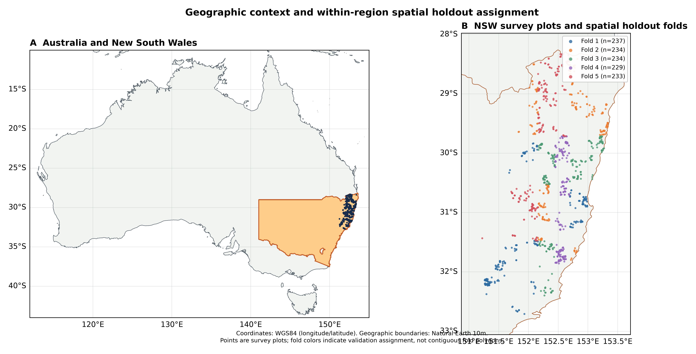
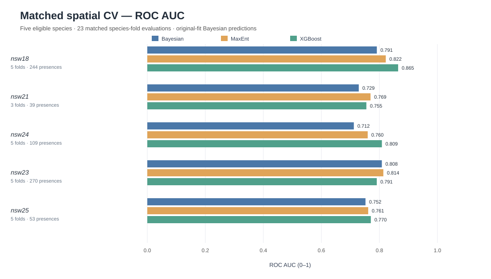
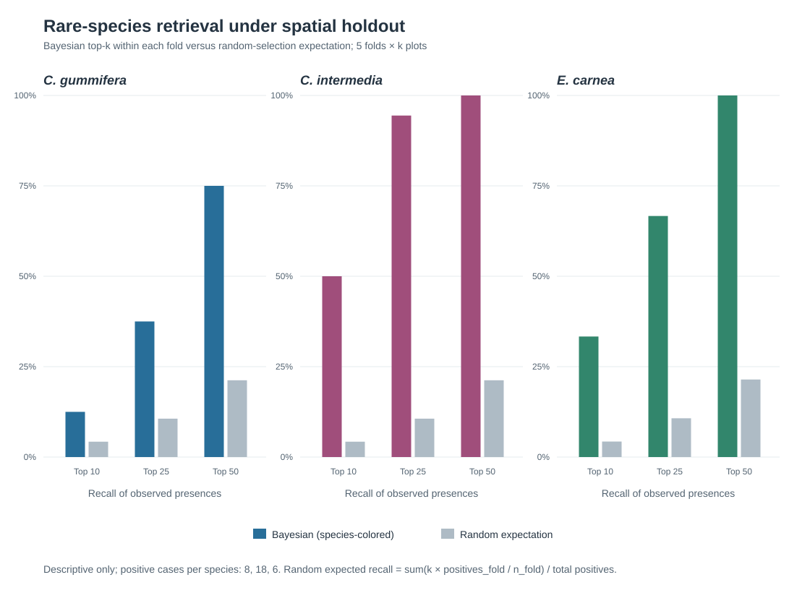

# Ecological Species Distribution Modeling — NSW, Australia

**Research portfolio | R · XGBoost · MaxEnt · Bayesian hierarchical modeling · Spatial validation**

[**View the visual case study**](https://ys30.github.io/projects/ecological-sdm-xgboost.html) · [**Inspect reproducible results**](results/matched_bayesian_maxent_xgboost_folds.csv) · [**Historical analyses**](results/README_HISTORICAL_DETAILED.md)

## The research question

How robust are species distribution model rankings when evaluated on the **same geographically held-out records**, and can their predictions support **fixed-budget surveys of sparsely observed taxa**?

**Data:** Public `disdat` NSW open-forest benchmark: **1,167 plots**, **8 anonymized taxa**, **9,336 plot–taxon observations**, **747 recorded detections**. Observed non-detections are not detection-corrected absences.

## Geographic study design — Figure 1

**Figure 1.** Geographic context and plot-level five-fold holdout assignments. A 4×4 longitude/latitude quantile grid allocates entire cells to folds. **No distance buffer:** 218/1,167 held-out plots were within 5 km of training plots; 37 were within 1 km. Results characterize withheld plots **within NSW**, not an independent-region transfer experiment.

## Matched three-model results

Identical held-out evaluation records: **23 eligible taxon–fold cells across five taxa**.

| Implemented pipeline | Mean ROC AUC | Distinctive modeling assumption |
|---|---:|---|
| **Pooled XGBoost** | **0.8016** | Gradient-boosted trees; taxon identity and environmental/categorical predictors |
| **Taxon-specific MaxEnt** | 0.7865 | Regularized suitability from four environmental predictors; surveyed non-detections as background approximation |
| **Hierarchical Bayesian SDM** | 0.7610 | Bernoulli occurrence model; partial pooling of taxon intercepts and selected slopes |

**Mean paired XGBoost–MaxEnt AUC difference: +0.0151.** This is a *descriptive pipeline comparison*, **not** an isolated algorithm effect: models have unequal information sets and score interpretations. The archived XGBoost benchmark uses a **fixed 300-round configuration**, not nested spatially tuned hyperparameters.

[Matched species metrics](results/matched_bayesian_maxent_xgboost_species.csv) · [Matched fold metrics](results/matched_bayesian_maxent_xgboost_folds.csv) · [Average precision figure](results/figures/23_three_model_ap_publication.svg)

## What changes the model ranking?

**Fold-local XGBoost feature encoding** gave similar discrimination to the archived full-feature configuration. **Removing taxon identity** substantially reduced pooled XGBoost performance, but changes the prediction task rather than isolating an encoding effect.

[Feature-representation sensitivity script](scripts/41_xgboost_spatial_encoding_sensitivity.R) · [Bayesian five-fold convergence audit](results/BAYESIAN_FIVE_FOLD_CONVERGENCE_FINAL.md)

## Practical use: rare-taxon survey prioritization

**Why evaluate rare taxa differently?** Three taxa had too few positives in some held-out folds to support the same per-fold ROC AUC comparison as the five evaluable taxa. Rather than exclude them, we asked a practical question: *with a fixed number of plots to resurvey, how many previously recorded detections would a model-ranked shortlist capture?*

**Evaluation protocol:** In each of the five held-out geographic folds, rank plots using the hierarchical Bayesian model and select the top 10, 25 or 50. Count observed detections in those selections and compare with **fold-specific random selection** at the identical budget. This is retrospective screening, not prospective validation.

**At top 25 plots per fold:** 125 / 1,167 plots screened (10.7%).

| Anonymous taxon | Recorded detections | Captured | Recall | Expected under random | Enrichment |
|---|---:|---:|---:|---:|---:|
| `nsw19` | 8 | 3 | 37.5% | 0.85 | **3.5×** |
| `nsw20` | 18 | 17 | 94.4% | 1.91 | **8.9×** |
| `nsw22` | 6 | 4 | 66.7% | 0.64 | **6.2×** |

**Interpretation:** The model concentrated known detections more effectively than random selection in this historical survey, especially for `nsw20`. Performance was heterogeneous: `nsw19` still missed five of eight recorded detections at top 25. With only 6–18 positives per taxon, percentages are sensitive to individual observations; the enrichment factors are descriptive, not estimates with demonstrated prospective generalizability.

**Decision value:** Ranked shortlists could guide *where to investigate first* when field resources are constrained. Deployment requires explicit survey cost and access constraints, spatial coverage, detection-probability modeling and prospective independent evaluation. Observed non-detection is not proof of absence, and retrospective recall is not expected future discovery yield.

[Fold-level top-k data](results/bayesian_rare_species_within_fold_retrieval.csv) · [Fold-specific random baseline and enrichment](results/bayesian_rare_species_random_baseline.csv)

## Reproducibility and limitations

- **Spatial evaluation:** five unbuffered geographic folds, with plots kept intact across taxa.
- **Predictor comparability:** XGBoost uses more information than MaxEnt and Bayesian models; differences should not be presented as algorithm-only effects.
- **Bayesian diagnostics:** four-chain confirmation fits passed archived convergence thresholds; matched figures use original-fit Bayesian predictions because complete long-chain observation-level prediction artifacts were not retained.
- **Practical interpretation:** results support within-region ranking and retrospective screening, not calibrated occupancy, independent geographic transfer or a prospective field survey.

**Code and results are public; the journal manuscript and appendix remain private.** Older analyses, different validation protocols and historical draft links are preserved in the [historical README](results/README_HISTORICAL_DETAILED.md), not mixed into the current matched-model headline.

**Map provenance:** [GitHub Actions geographic Figure 1 build](https://github.com/ys30/Ecological-SDM-XGBoost/actions/runs/41540075797).
