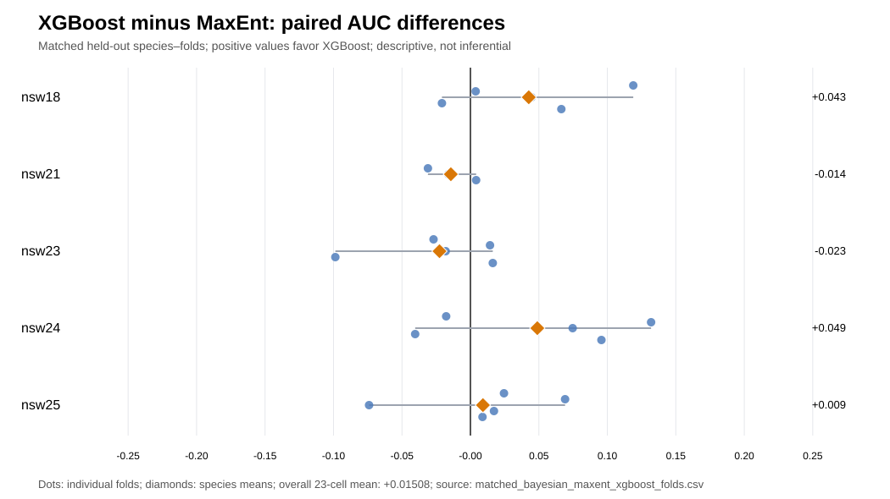
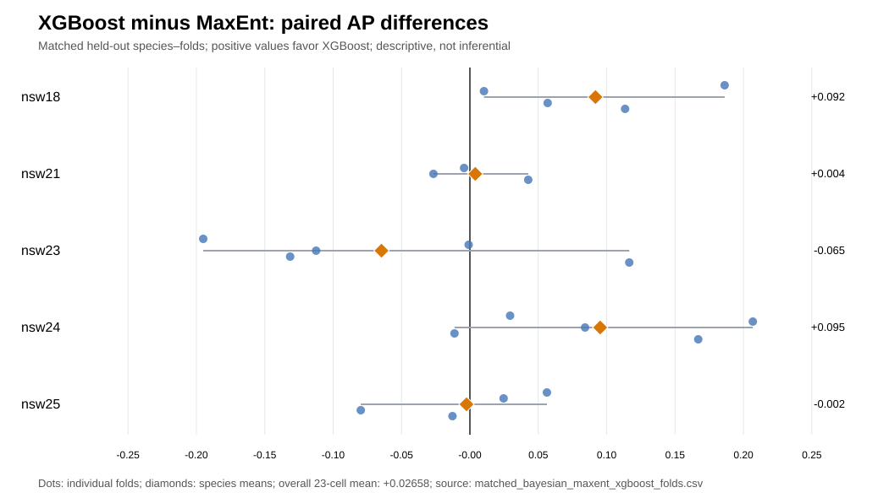
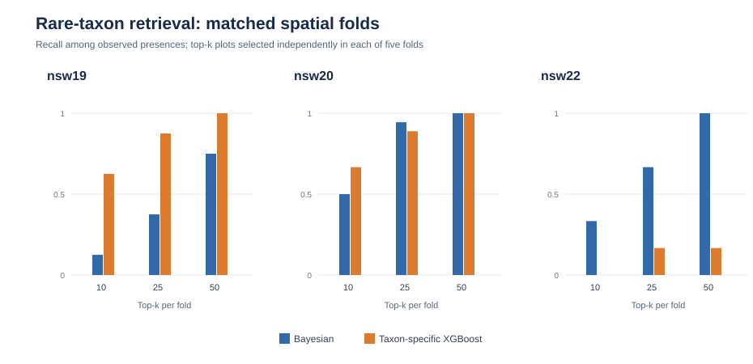

# Ecological Species Distribution Modeling — NSW, Australia

**Research portfolio | R · XGBoost · MaxEnt · Bayesian hierarchical modeling · Spatial validation**

[**View the visual case study**](https://ys30.github.io/projects/ecological-sdm-xgboost.html) · [**Inspect reproducible results**](results/matched_bayesian_maxent_xgboost_folds.csv) · [**Historical analyses**](results/README_HISTORICAL_DETAILED.md)

## The research question

How robust are species distribution model rankings when evaluated on the **same geographically held-out records**, and can their predictions support **fixed-budget surveys of sparsely observed taxa**?

**Data:** Public `disdat` NSW open-forest benchmark: **1,167 plots**, **8 anonymized taxa**, **9,336 plot–taxon observations**, **747 recorded detections**. Observed non-detections are not detection-corrected absences.

## Geographic study design — Figure 1

**Figure 1.** Geographic context and plot-level five-fold holdout assignments. A 4×4 longitude/latitude quantile grid allocates entire cells to folds. **No distance buffer:** 218/1,167 held-out plots were within 5 km of training plots; 37 were within 1 km. Results characterize withheld plots **within NSW**, not an independent-region transfer experiment.

## Matched three-model results

Identical held-out evaluation records: **23 eligible taxon–fold cells across five taxa**.

| Implemented pipeline | Mean ROC AUC | Distinctive modeling assumption |
|---|---:|---|
| **Pooled XGBoost** | **0.8016** | Gradient-boosted trees; taxon identity and environmental/categorical predictors |
| **Taxon-specific MaxEnt** | 0.7865 | Regularized suitability from four environmental predictors; surveyed non-detections as background approximation |
| **Hierarchical Bayesian SDM** | 0.7610 | Bernoulli occurrence model; partial pooling of taxon intercepts and selected slopes |

**Mean paired XGBoost–MaxEnt AUC difference: +0.0151.** This is a *descriptive pipeline comparison*, **not** an isolated algorithm effect: models have unequal information sets and score interpretations. The archived XGBoost benchmark uses a **fixed 300-round configuration**, not nested spatially tuned hyperparameters.

[Matched species metrics](results/matched_bayesian_maxent_xgboost_species.csv) · [Matched fold metrics](results/matched_bayesian_maxent_xgboost_folds.csv) · [Average precision figure](results/figures/23_three_model_ap_publication.svg)

### Spatial-fold heterogeneity — paired differences

XGBoost exceeded MaxEnt in **14/23 eligible ROC AUC cells** (mean paired ΔAUC **+0.01508**) and **13/23 AP cells** (mean paired ΔAP **+0.02658**). The direction varies by taxon and fold. Points are descriptive; the 23 cells are not independent replicates. [Figure methods and audit caveats](results/MATCHED_PAIRED_FIGURES_AND_METHOD_AUDIT.md).

## What changes the model ranking?

**Fold-local XGBoost feature encoding** is implemented as a sensitivity analysis, but its generated result CSVs were not found on the current main branch during the latest audit. Its numerical impact should be treated as **pending artifact verification**, rather than as a confirmed result. Removing taxon identity also changes the prediction task, rather than isolating an encoding effect.

[Feature-representation sensitivity script](scripts/41_xgboost_spatial_encoding_sensitivity.R) · [Bayesian five-fold convergence audit](results/BAYESIAN_FIVE_FOLD_CONVERGENCE_FINAL.md)

## Practical use: rare-taxon survey prioritization

**Why evaluate rare taxa differently?** Three taxa had too few positives in some held-out folds to support the same per-fold ROC AUC comparison as the five evaluable taxa. Rather than exclude them, we asked a practical question: *with a fixed number of plots to resurvey, how many previously recorded detections would a model-ranked shortlist capture?*

**Evaluation protocol:** In each of the five held-out geographic folds, rank plots using the hierarchical Bayesian model and select the top 10, 25 or 50. Count observed detections in those selections and compare with **fold-specific random selection** at the identical budget. This is retrospective screening, not prospective validation.

**At top 25 plots per fold:** 125 / 1,167 plots screened (10.7%).

| Anonymous taxon | Recorded detections | Captured | Recall | Expected under random | Enrichment |
|---|---:|---:|---:|---:|---:|
| `nsw19` | 8 | 3 | 37.5% | 0.85 | **3.5×** |
| `nsw20` | 18 | 17 | 94.4% | 1.91 | **8.9×** |
| `nsw22` | 6 | 4 | 66.7% | 0.64 | **6.2×** |

**Interpretation:** The model concentrated known detections more effectively than random selection in this historical survey, especially for `nsw20`. Performance was heterogeneous: `nsw19` still missed five of eight recorded detections at top 25. With only 6–18 positives per taxon, percentages are sensitive to individual observations; the enrichment factors are descriptive, not estimates with demonstrated prospective generalizability.

**Decision value:** Ranked shortlists could guide *where to investigate first* when field resources are constrained. Deployment requires explicit survey cost and access constraints, spatial coverage, detection-probability modeling and prospective independent evaluation. Observed non-detection is not proof of absence, and retrospective recall is not expected future discovery yield.

[Fold-level top-k data](results/bayesian_rare_species_within_fold_retrieval.csv) · [Fold-specific random baseline and enrichment](results/bayesian_rare_species_random_baseline.csv)

## Matched Bayesian vs XGBoost rare-taxon retrieval

A second, pipeline-level comparison uses **identical held-out spatial folds, anonymous taxa and inspection budgets**. Here, XGBoost is the **taxon-specific four-environment-predictor** pipeline; the earlier figure above is Bayesian-only.

| Taxon | Observed presences | Top 25/fold: Bayesian | Top 25/fold: XGBoost |
|---|---:|---:|---:|
| `nsw19` | 8 | 3/8 (37.5%) | **7/8 (87.5%)** |
| `nsw20` | 18 | **17/18 (94.4%)** | 16/18 (88.9%) |
| `nsw22` | 6 | **4/6 (66.7%)** | 1/6 (16.7%) |

**What matters:** the preferred model changes by taxon and inspection budget. A single average AUC would obscure the very different screening outcomes for `nsw19` and `nsw22`. These are retrospective, within-region **pipeline comparisons**, not independent field trials or algorithm-only causal effects.

[Verified matched counts and interpretation](results/RARE_TAXON_MATCHED_BAYES_XGBOOST_VERIFIED.md) · [Machine-readable fold-matched comparison](results/rare_taxon_bayesian_xgboost_matched_topk.csv) · [Reproduction script](scripts/54_compare_rare_taxon_retrieval.py)

## Common-input XGBoost ablation: taxon identity matters

Across eight taxa, the equal-taxon mean **pooled minus taxon-specific** AUC difference was **−0.0123** (exploratory taxon-bootstrap range −0.0510 to +0.0220). Removing species identity from the pooled model decreased AUC by **0.3131** on the same common four-environment-predictor experiment. These findings distinguish model architecture from the information supplied to it; they do not establish independent cross-region generalization.

[Verified common-input results](results/EMS_V614_COMMON_INPUT_VERIFIED_RESULTS.md)

## Reproducibility and limitations

- **Spatial evaluation:** five unbuffered geographic folds, with plots kept intact across taxa.
- **Predictor comparability:** XGBoost uses more information than MaxEnt and Bayesian models; differences should not be presented as algorithm-only effects.
- **Bayesian diagnostics:** four-chain confirmation fits passed archived convergence thresholds; matched figures use original-fit Bayesian predictions because complete long-chain observation-level prediction artifacts were not retained.
- **Practical interpretation:** results support within-region ranking and retrospective screening, not calibrated occupancy, independent geographic transfer or a prospective field survey.

**The current journal manuscript and appendix are managed separately from the public results.** Historical manuscript-like draft files and older analyses remain accessible in this public repository; they have not been migrated or deleted. Different validation protocols and historical materials are linked from the [historical README](results/README_HISTORICAL_DETAILED.md), not mixed into the current matched-model headline.

**Map provenance:** [GitHub Actions geographic Figure 1 build](https://github.com/ys30/Ecological-SDM-XGBoost/actions/runs/41540075797).
